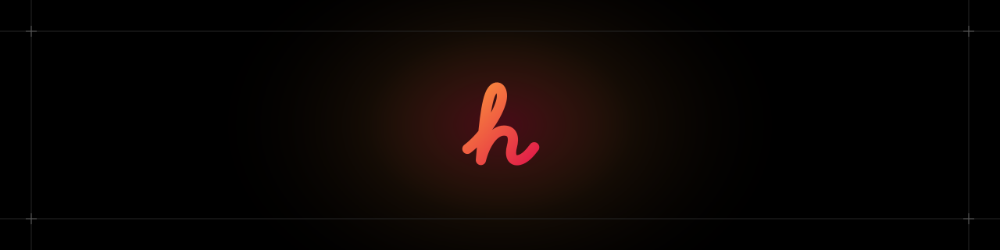

<p align="center">
  <br/>
  Personal website of <a href="https://hamzakargin.com">Hamza Kargin</a>, JavaScript Software Engineer &mdash;
  <br/>
  a static Astro site in four languages, with zero client-side React.
  <br/><br/>
</p>

<div align="center">

[](https://github.com/hamzakargin/hamzakargin.com/actions/workflows/ci.yml)
[](https://github.com/hamzakargin/hamzakargin.com/actions/workflows/deploy.yml)
[](LICENSE)

</div>

## Getting started

Requires [Bun](https://bun.sh) 1.4 or later.

```sh
bun install
bun run dev
```

Run `bun run check` before committing. It checks formatting, lint, types, unused code and spelling.

```sh
bun run test       # unit tests
bun run test:e2e   # end-to-end tests against the production build
```

## Structure

```text
src/
├── assets/       Images processed by Astro
├── components/   Astro components, shadcn/ui in ui/
├── content/      Blog posts, ship log, projects and profile data
├── i18n/         Translations and locale helpers
├── layouts/      Page shell
├── lib/          Data loading, social images and helpers
├── pages/        Routes, localized under [lang]/
└── styles/       Theme
```

## Adding content

Everything lives in `src/content/` and is validated at build time.

| Content                                      | Location                 |
| -------------------------------------------- | ------------------------ |
| Blog post                                    | `blog/<slug>.mdx`        |
| Ship log entry                               | `log/<date>-<name>.yaml` |
| Project                                      | `projects/<name>.md`     |
| Experience, education, certifications, stack | `*.yaml`                 |

Posts with `draft: true` are hidden. Social images, RSS, sitemap and search are generated from the content.

## Deployment

Pushes to `main` build the site and deploy it to [Cloudflare Workers](https://developers.cloudflare.com/workers/static-assets/).

### Self-hosting

The site is fully static, so it also runs anywhere with Docker. The image serves the build with nginx:

```sh
docker build -t hamzakargin.com .
docker run -p 8080:80 hamzakargin.com
```

Headers and redirects live in `public/_headers` and `public/_redirects` for Workers, and in `nginx.conf` for Docker. Keep them in sync.

## Contributing

Found a bug or a translation mistake? Check out the [Contributing Guide](CONTRIBUTING.md).

## License

The code is [MIT](LICENSE). Feel free to use it for your own site. The content (blog posts, images and personal information) is not covered by the license, so please don't reuse it.
